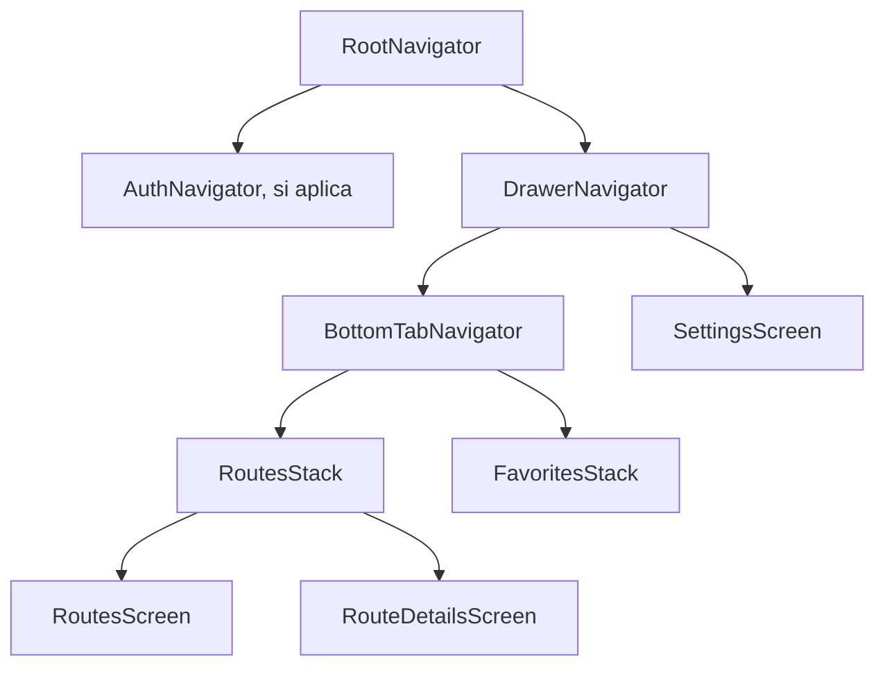

# Guía de arquitectura React Native: layouts, navegadores y componentes

Referencia de trabajo para Patrick Solis, Omar Quintanilla y Luis Saravia — Mi Ruta.

Fecha: 19 de noviembre de 2026.

## 1. Propósito y alcance

Esta guía documenta la forma de organizar aplicaciones React Native que Patrick utilizó en sus proyectos Mobile_Final_Examn, Registration_Mobile_App y ProductsMobileApp. Formaliza ese enfoque para reutilizarlo en Mi Ruta y en otros proyectos.

La base confirmada para Mi Ruta es React Native con Expo, TypeScript, pnpm y SQLite. La navegación aquí descrita utiliza React Navigation con navegadores explícitos. Backend, almacenamiento remoto, autenticación y funcionalidades del producto siguen pendientes de definición. Las pantallas de rutas, favoritos y ajustes que aparecen como ejemplo no constituyen requisitos aprobados.

El principio central es separar **la estructura de navegación**, **la composición visual compartida**, **el contenido de las pantallas** y **el acceso a datos**.

Esta es una convención de proyecto por responsabilidades; no pretende ser una arquitectura oficial con un nombre particular.

## 2. Descripción de la arquitectura

La aplicación se compone de navegadores que registran pantallas y otros navegadores. Los layouts aportan el marco visual común. Las pantallas componen componentes de contenido, consumen estado y ejecutan acciones mediante hooks o servicios. Los providers distribuyen dependencias y estado compartido.

| Elemento | Responsabilidad | Ejemplos |
| --- | --- | --- |
| Entrada de la aplicación | Montar providers y navegación raíz | `App.tsx` |
| Navegadores | Registrar destinos, jerarquías, transiciones y opciones de navegación | `BottomTabNavigator`, `DrawerNavigator`, `RoutesStack` |
| Pantallas | Componer una vista completa y conectar su contenido con datos y navegación | `RoutesScreen`, `RouteDetailsScreen` |
| Layouts | Compartir estructura visual, espacios, fondos y encabezados propios | `ScreenLayout`, `AuthLayout`, `ScreenHeading` |
| Componentes | Implementar contenido y controles reutilizables | `RouteList`, `RouteCard`, `SearchInput` |
| Contextos y providers | Compartir estado o dependencias con un alcance definido | `DatabaseProvider`, futuro `SessionProvider` |
| Hooks | Encapsular comportamiento React reutilizable | `useRoutes`, `useFavorites` |
| Servicios | Encapsular operaciones de datos o APIs | `routesService`, futuro `apiClient` |
| Configuración | Centralizar configuración técnica y creación de clientes | configuración de base de datos |

Los archivos de navegación deben permitir entender la aplicación sin tener que leer formularios, SQL o llamadas HTTP.

## 3. Organización de carpetas

La estructura siguiente es una referencia. Se crean archivos cuando exista una necesidad real; no hace falta generar todas las carpetas al iniciar.

| Ruta | Contenido |
| --- | --- |
| `App.tsx` | Providers y `NavigationContainer` |
| `src/layout/ScreenLayout.tsx` | Marco visual común de una pantalla |
| `src/layout/ScreenHeading.tsx` | Encabezado propio reutilizable |
| `src/layout/HeadingStyles.ts` | Opciones visuales de headers y tabs, si se comparten |
| `src/layout/AuthStyles.ts` | Estilos compartidos de autenticación, si se incorpora |
| `src/navigators/RootNavigator.tsx` | Selección o composición del flujo raíz |
| `src/navigators/BottomTabNavigator.tsx` | Secciones principales |
| `src/navigators/DrawerNavigator.tsx` | Menú lateral, si el producto lo necesita |
| `src/navigators/AuthNavigator.tsx` | Login, signup y recuperación, si se incorporan |
| `src/navigators/stack_navigators/RoutesStack.tsx` | Pantallas relacionadas con una sección |
| `src/navigators/types.ts` | Tipos de rutas y parámetros |
| `src/screens/` | Composición de pantallas completas |
| `src/components/` | Contenido reutilizable, agrupable por sección |
| `src/context/` | Providers y hooks de acceso a contextos |
| `src/hooks/` | Comportamientos React compartidos |
| `src/services/` | Operaciones de datos y APIs |
| `src/config/` | Inicialización y configuración técnica |
| `src/database/` | Esquema, migraciones y consultas SQLite, cuando haga falta separarlas |
| `src/types/` | Tipos de dominio compartidos |

Se conserva `layout/` y `stack_navigators/` como en el enfoque original. Para código nuevo se usa **BottomTab**, con «Tab», aunque los repositorios originales contienen nombres como `BottomTap`.

### Dos formas válidas de organizar las pantallas

En los proyectos originales, algunos archivos dentro de `stack_navigators/` declaran tanto la pantalla que compone el contenido como el stack que la registra. Ese patrón sigue siendo válido si la composición es breve.

Para pantallas que crecen, esta guía propone extraer esa composición a `screens/`. Es una evolución del enfoque original, no un requisito para crear otra capa en cada archivo. En ambos casos, formularios, listas, mapas y lógica de datos se mantienen fuera de la definición del navegador.

## 4. Navegadores y sus responsabilidades

### Bottom Tab Navigator

Representa las secciones principales accesibles mediante la barra inferior. Cada tab puede apuntar a una pantalla simple o a un stack cuando esa sección tiene varios destinos.

Por ejemplo, un tab «Rutas» podría contener un listado y el detalle de una ruta. El tab cambia de sección; el stack administra el recorrido dentro de ella.

El archivo define nombres de destinos, componentes registrados, títulos, iconos y opciones de la barra. No obtiene datos ni construye el contenido de las pantallas.

### Drawer Navigator

Representa el menú lateral para destinos secundarios o secciones que se decida colocar allí. Puede contener el navegador de tabs junto con ajustes u otros destinos.

También puede existir un drawer dentro de una sección si sus opciones solo pertenecen a esa sección. La posición se decide por el alcance del menú; no todos los tabs necesitan un drawer propio.

### Stack Navigator

Administra una secuencia de pantallas relacionadas, su historial y la navegación hacia atrás. Un mismo stack puede registrar listado, detalle y otros destinos relacionados.

**Una pantalla no equivale a un stack.** En los proyectos originales había stacks de una sola pantalla y stacks anidados. Se puede mantener ese patrón cuando aporta una frontera útil, pero no es obligatorio crear un navegador nuevo por cada vista.

### Auth Navigator

Agrupa el flujo de autenticación cuando existe: login, signup y recuperación. Es hermano de los otros archivos de navegación en la carpeta, pero su posición en ejecución depende del flujo de acceso.

Si se requiere autenticación, la raíz decide qué flujo montar según el estado de sesión y contempla el estado inicial de restauración. Si Mi Ruta permite uso sin cuenta, el flujo de autenticación se incorpora cuando lo requiera una función. La estructura de carpetas no obliga a exigir login.

## 5. Jerarquía de navegación

Estar al mismo nivel en la carpeta no significa ser hermanos en el árbol de navegación.

Ejemplo con drawer global y tabs principales:



Las ramas Auth y aplicación representan alternativas según el estado de acceso, cuando exista esa condición.

| Composición | Efecto esperado |
| --- | --- |
| Drawer contiene Tabs | El menú lateral pertenece al nivel que agrupa las secciones principales. |
| Tabs contienen un Stack | Las pantallas internas de ese stack permanecen dentro del tab; la barra inferior normalmente sigue visible. |
| Un Stack raíz contiene Tabs y un detalle como hermanos | El detalle queda fuera del navegador de tabs y puede ocupar la pantalla sin su barra inferior. |
| Un tab contiene un Drawer | El menú lateral queda limitado a esa sección. |

Antes de anidar navegadores, definir qué barras deben verse, quién controla el header y qué debe hacer el botón Atrás. Cada navegador administra su propio estado; la anidación también afecta cómo se resuelven las acciones y las opciones.

## 6. Layouts y encabezados

`ScreenLayout` recibe contenido mediante `children` y aplica el marco común: fondo, contenedor, espaciado y, si corresponde, un encabezado propio.

No realiza consultas, abre conexiones, decide la sesión ni registra destinos. Tampoco debe imponer un centrado o padding único que impida pantallas de mapa a pantalla completa o listas extensas.

Ejemplo ilustrativo de un layout con header propio:

```tsx
import type { PropsWithChildren } from 'react';
import { StyleSheet, Text, View } from 'react-native';
import { SafeAreaView } from 'react-native-safe-area-context';

type Props = PropsWithChildren<{
  title?: string;
  padded?: boolean;
}>;

export function ScreenLayout({ children, title, padded = true }: Props) {
  return (
    <SafeAreaView style={styles.screen}>
      {title ? <Text style={styles.title}>{title}</Text> : null}
      <View style={[styles.content, padded && styles.padding]}>
        {children}
      </View>
    </SafeAreaView>
  );
}

const styles = StyleSheet.create({
  screen: { flex: 1, backgroundColor: '#fff' },
  content: { flex: 1 },
  padding: { paddingHorizontal: 16 },
  title: { fontSize: 24, fontWeight: '600', padding: 16 },
});
```

Este ejemplo presupone un `SafeAreaProvider` en la raíz y headers de navegación ocultos. Si se utiliza el header del navegador, se ajustan los bordes de safe area para no duplicar el espacio superior.

| Elemento | Función |
| --- | --- |
| Header del navegador | Título, botón Atrás y acciones asociadas a la navegación. |
| `ScreenHeading` | Encabezado visual dentro del contenido. |
| `HeadingStyles` | Opciones visuales compartidas; no es un componente por sí mismo. |
| `AuthStyles` | Estilos compartidos de formularios de acceso. |
| `AuthLayout` | Estructura compartida de esas pantallas, cuando los estilos solos no bastan. |

Elegir quién es dueño del encabezado de cada pantalla. Si el layout dibuja el header principal, ocultar los headers de los navegadores involucrados para evitar duplicados y proporcionar los controles de navegación necesarios.

No envolver automáticamente todas las pantallas en un `ScrollView`: una `FlatList` o un mapa necesitan controlar su propio espacio y desplazamiento.

## 7. Ejemplo de separación entre stack, pantalla y contenido

Los siguientes fragmentos muestran responsabilidades; no constituyen una aplicación completa. Presuponen componentes y tipos creados en las rutas indicadas.

### El stack registra destinos

```tsx
// src/navigators/stack_navigators/RoutesStack.tsx
import { createNativeStackNavigator } from '@react-navigation/native-stack';
import { RoutesScreen } from '../../screens/RoutesScreen';
import { RouteDetailsScreen } from '../../screens/RouteDetailsScreen';

export type RoutesStackParamList = {
  Routes: undefined;
  RouteDetails: { routeId: string };
};

const Stack = createNativeStackNavigator<RoutesStackParamList>();

export function RoutesStack() {
  return (
    <Stack.Navigator screenOptions={{ headerShown: false }}>
      <Stack.Screen name="Routes" component={RoutesScreen} />
      <Stack.Screen name="RouteDetails" component={RouteDetailsScreen} />
    </Stack.Navigator>
  );
}
```

### La pantalla compone el layout y el contenido

```tsx
// src/screens/RoutesScreen.tsx
import type { NativeStackScreenProps } from '@react-navigation/native-stack';
import type { RoutesStackParamList } from '../navigators/stack_navigators/RoutesStack';
import { ScreenLayout } from '../layout/ScreenLayout';
import { RouteList } from '../components/routes/RouteList';
import { useRoutes } from '../hooks/useRoutes';

type Props = NativeStackScreenProps<RoutesStackParamList, 'Routes'>;

export function RoutesScreen({ navigation }: Props) {
  const { routes, loading, error, retry } = useRoutes();

  return (
    <ScreenLayout title="Rutas">
      <RouteList
        routes={routes}
        loading={loading}
        error={error}
        onRetry={retry}
        onSelect={(routeId) =>
          navigation.navigate('RouteDetails', { routeId })
        }
      />
    </ScreenLayout>
  );
}
```

`RouteList` recibe datos y callbacks. `useRoutes` administra carga y estado React. El servicio ejecuta la operación de datos. En una pantalla pequeña se puede consumir el servicio directamente; extraer un hook tiene sentido cuando el comportamiento se comparte o empieza a dificultar la lectura.

Pasar identificadores como parámetros facilita que la pantalla destino consulte los datos vigentes. Los parámetros de navegación deben poder serializarse; no transportar conexiones, callbacks o clientes de base de datos.

## 8. Contextos, configuración y servicios

### Contextos y providers

Compartir una conexión SQLite mediante un provider mantiene una dependencia disponible para las pantallas que la necesitan. Un contexto de sesión puede compartir la sesión; un contexto de conectividad puede compartir el estado de red.

El estado de un input o un modal que solo utiliza una pantalla permanece local. Un contexto no debe convertirse en un contenedor de todo el estado de la aplicación.

### Configuración y clientes

`config/` contiene configuración técnica e inicialización de clientes. `services/` contiene operaciones con intención de negocio, como listar rutas o guardar un favorito.

Un cliente Axios compartido evita repetir URL base y configuración cuando se incorpora una API. La existencia de esta carpeta no implica que Mi Ruta ya tenga un backend ni que Axios sea obligatorio.

No abrir una base de datos en cada render o en cada componente. Definir un único dueño de su inicialización para cada alcance de la aplicación: un provider o un módulo compartido. No mezclar dos mecanismos independientes para el mismo recurso.

### SQLite

En los proyectos revisados, `ConnectionContext` abre SQLite con `openDatabaseAsync` y expone la conexión mediante `useConnection`. Mi Ruta puede conservar esa idea. Expo también ofrece `SQLiteProvider` y `useSQLiteContext` para distribuir la conexión sin recrear ese mecanismo manualmente.

La distribución propuesta de responsabilidades es:

| Responsabilidad | Ubicación |
| --- | --- |
| Abrir y distribuir la conexión | Provider de base de datos |
| Crear o actualizar el esquema | Inicialización y migraciones en `database/` |
| Ejecutar consultas | Servicio o módulo de consultas |
| Administrar carga, errores y refresco React | Hook o pantalla |
| Dibujar resultados | Componentes |

Inicializar el esquema antes de permitir consultas. Mostrar estados de carga y error si la inicialización falla. Usar parámetros para valores dinámicos y transacciones para operaciones que deban completarse juntas.

SQLite aporta persistencia local. Sincronización, respaldo remoto y resolución de conflictos requieren decisiones adicionales y quedan fuera de esta guía.

## 9. Flujo para desarrollar una funcionalidad

1. Definir qué debe hacer el usuario y los destinos involucrados.
2. Ubicarla en un tab, drawer, stack existente o flujo nuevo según su alcance.
3. Definir parámetros TypeScript y comportamiento de Atrás.
4. Crear el contenido en `components/` y componer la pantalla con su layout.
5. Implementar las operaciones de datos en servicios; inicializar cambios de esquema mediante migraciones cuando existan.
6. Incorporar estado local, hooks o contextos según el alcance real.
7. Registrar los destinos en el navegador responsable y revisar headers y barras.
8. Verificar el flujo y actualizar la documentación afectada.

Para una pantalla nueva en un stack existente, normalmente basta con un componente de pantalla, su contenido y una entrada `Stack.Screen`. Crear otro stack requiere una razón de navegación.

## 10. Reglas de trabajo para desarrolladores y agentes

- Leer las instrucciones y documentación existentes antes de modificar un módulo.
- Mantener consistentes los nombres y la organización del proyecto.
- Mantener los navegadores centrados en la estructura de navegación.
- Mantener SQL, HTTP y reglas de negocio fuera de los layouts.
- Componer el contenido mediante componentes y extraer comportamiento compartido cuando sea útil.
- Registrar cada pantalla en el nivel que produce el comportamiento visual deseado.
- Evitar stacks o providers adicionales que no aporten una responsabilidad concreta.
- Mantener un `NavigationContainer` raíz para este árbol de aplicación.
- Tipar rutas y parámetros; evitar `any` como forma de resolver errores de navegación.
- Usar pnpm y conservar `pnpm-lock.yaml`; instalar módulos Expo con versiones compatibles con el SDK del proyecto.
- No convertir las referencias de clase en decisiones de producto: login, drawer y servicios remotos se incorporan cuando se definan.
- Documentar cambios de jerarquía, parámetros públicos y esquema de datos.

## 11. Validación de una implementación

| Área | Comprobación |
| --- | --- |
| Inicio | Providers e inicialización completan o presentan un error recuperable. |
| Tabs | Cada tab abre la sección correcta. |
| Drawer | Destinos y alcance del menú coinciden con la jerarquía elegida. |
| Stack | Abrir detalle y volver conserva el comportamiento esperado. |
| Presentación | No se duplican headers ni espacios de safe area; listas y mapas ocupan el espacio correcto. |
| Datos | Se distinguen carga, error, vacío y resultado. |
| SQLite | Los datos sobreviven al reinicio; la inicialización funciona en una instalación nueva y al actualizar el esquema. |
| Autenticación, si existe | Restaurar sesión, entrar y salir monta el flujo correcto; no permite volver a pantallas restringidas tras cerrar sesión. |
| Tipos | El chequeo TypeScript del proyecto pasa. |

Esta guía define un enfoque de organización. La validación de una aplicación requiere ejecutarla con sus dependencias y probarla en los dispositivos objetivo.

## 12. Procedencia y referencias

### Proyectos que originan la convención

- [Mobile_Final_Examn](https://github.com/Patrick-beep-ui/Mobile_Final_Examn), revisión `14a40b71d60e1945a07cbbfd51a2979dda47d8ae`: tabs, stacks, layout compartido, SQLite y Axios.
- [Registration_Mobile_App](https://github.com/Patrick-beep-ui/Registration_Mobile_App), revisión `82b4a03a8c8dba32038625cbb883672ba8ff347b`: drawer, tabs, registro/login, contextos de usuarios y sesión.
- [ProductsMobileApp](https://github.com/Patrick-beep-ui/ProductsMobileApp), revisión `16fa843487862b22c743e5699c6ac7f9671f62fa`: stacks, SQLite y caché utilizada sin conexión.

La carpeta opcional `screens/`, la extracción de consultas y la inicialización mediante migraciones son ajustes propuestos en esta guía. No se presentan como características ya implementadas en los tres repositorios.

### Documentación técnica

- [React Navigation: nesting navigators](https://reactnavigation.org/docs/nesting-navigators/): composición y comportamiento de navegadores anidados.
- [React Navigation: authentication flows](https://reactnavigation.org/docs/auth-flow/): flujos condicionados por la sesión.
- [Expo SQLite](https://docs.expo.dev/versions/latest/sdk/sqlite/): persistencia local, provider y API de consultas. Consultar la versión correspondiente al SDK instalado.

La organización aquí descrita utiliza configuración explícita de React Navigation. Expo Router es otro enfoque de organización del enrutamiento y no se incorpora como requisito de esta guía.
